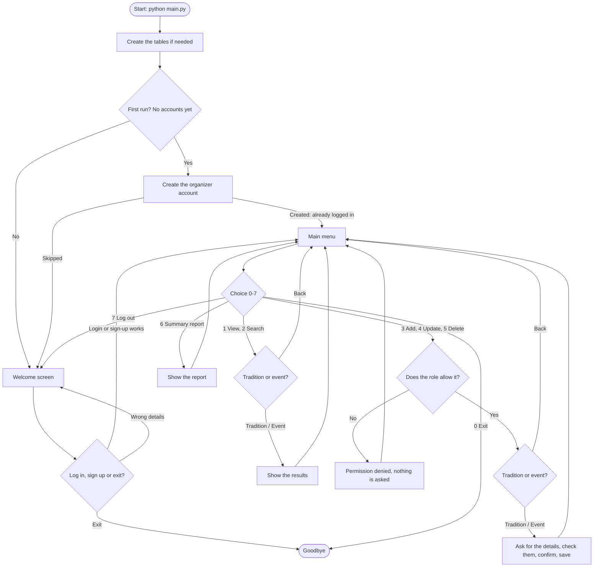

# Community Culture and Heritage Management System

This is our command line app for keeping a record of the traditions and events
in a community. You use it from a menu in the terminal, and everything is saved
in a SQLite database so it is still there the next time you open it.

Peer Learning Project 2, Group 3 (African Leadership University, BSE Year 1,
Trimester 2)

## Team

| Member | Role | Files |
|--------|------|-------|
| Deng | Project coordinator: startup, putting the parts together, run instructions | `main.py`, `README.md` |
| Davina | User journey: the menu flow, the decisions and the flowchart | `ui/menus.py`, architecture part of this README |
| Esther | Testing: checking that the code and the permissions work | `tests/` |
| (add name) | Service layer: rules, checks, permissions, accounts | `services/`, `utils/` |
| (add name) | Database layer: tables and SQL | `database/` |

## How to run it

You need Python 3.8 or newer. There is nothing to install.

```
python main.py
```

The first time, the app asks you to create the organizer account. After that
people can log in, or sign up as a volunteer from the welcome screen. The data
goes in `heritage.db` in the folder you start the program from. To use a
different file, set `HERITAGE_DB`:

```
HERITAGE_DB=other.db python main.py
```

## How to run the tests

From the project folder:

```
python -m unittest discover -v
```

Every test makes its own in-memory database, so the tests never touch
`heritage.db`. If a test fails it shows the file and line.

## What it does

- Keep records of traditions (name, region, category, description) and events
  (name, date, location, an optional tradition it belongs to, description).
- View, search, add, update and delete records.
- A summary report with the totals, the upcoming events, and the traditions by
  category and by region.
- Log in with a role, so not everybody can change or delete things.

### Roles

| Action | Volunteer | Organizer |
|--------|:---------:|:---------:|
| View, search, report | yes | yes |
| Add a record | yes | yes |
| Update a record | no | yes |
| Delete a record | no | yes |

The first account created is the organizer, and everyone who signs up after that
is a volunteer. If your role is not allowed to do something, the app tells you
and goes back to the menu without asking you anything first.

## How the code is organised

There are three layers. Each one only talks to the layer under it, and `main.py`
connects them.

```
main.py              starts the program
   |
ui/menus.py          menu layer: what the user sees and types
   |
services/            service layer: the rules (checks, roles, accounts)
   |
database/            database layer: the tables and all the SQL
```

- **Menu** (`ui/menus.py`): shows the menu, reads the choice, calls a service and
  prints the result. It has no SQL and no rules of its own.
- **Services** (`services/` and `utils/validators.py`): check every answer, decide
  who is allowed to do what, handle passwords and work out the report numbers.
- **Database** (`database/`): creates the tables and runs the queries. It does
  not make any decisions.

This way a new rule only changes the service, and a new screen only changes the
menu. The services also check the role themselves, so a mistake in the menu
cannot let someone through.

### The user journey

`Menu.run()` in `ui/menus.py` is the main loop. It shows the menu, reads a
choice, runs that action and comes back to the menu, until the user picks exit.

- `run()` is the loop. Each choice leads to one action.
- `_pick_record_type()` is where the user picks a tradition or an event, or goes
  back.
- Add, update and delete each start with a role check (`_allowed()`). If the role
  is not allowed, the user is sent back before being asked for any input.
- Ctrl+C and Ctrl+D close the program politely, and a database error shows a
  message instead of crashing the menu.



The diagram above is written as text and GitHub draws it for us. If we make a
nicer flowchart image, it can go in a `docs/` folder and be linked here.

## Project structure

```
main.py                    entry point
ui/
    menus.py               the menu and the user journey
services/
    base.py                create, read, update, delete shared by both services
    tradition_service.py   rules for traditions
    event_service.py       rules for events
    auth_service.py        sign up and login
    permissions.py         what each role can do
    errors.py              PermissionDenied, NotFoundError, AuthError
utils/
    validators.py          clean_text, clean_date, clean_record_id, clean_choice
database/
    connection.py          connecting and sessions
    schema.py              the tables
    repository.py          all the SQL
tests/
    test_heritage.py       validators, services and database
    test_auth.py           accounts and passwords
    test_menu.py           the whole menu with fake keystrokes
```

## A few notes

- All queries use `?` placeholders, so what the user types never goes into the
  SQL text.
- Passwords are salted and hashed (PBKDF2), not saved as typed.
- There is no default login. The organizer account is made by whoever runs the
  app first.
- Bad input (empty names, wrong dates, unknown categories, a tradition ID that
  does not exist) is explained and asked again.
- If a tradition is deleted, its events stay and just lose the link.
